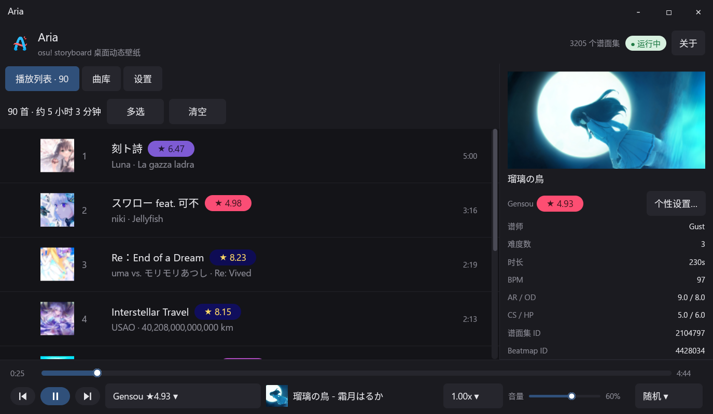

<p align="center">
  
</p>

# Aria

**Aria** -- **A**TRI **R**hythm **I**nteractive **A**nimation ~ 咏叹调
osu! storyboard 动态桌面壁纸

<p align="center">
  
</p>

## 快速开始

### Windows

Release 下载安装 exe 即用

安装包**不再内置 ffmpeg**,也不会自动安装:
- **不装也能正常运行**,只是视频 storyboard、视频时长探测等少数功能不可用;
- 需要时自己到 <https://ffmpeg.org/download.html> 下载,解压后把 `bin` 目录加入 PATH,
  或在「设置 → 路径」里手动指定 `ffmpeg` / `ffprobe`;
- 设置页「路径」区有「下载 ffmpeg」按钮,点它只是打开下载页,不会自动下载/安装。

### Linux(Wayland / KDE Plasma 6)

只支持 Wayland;壁纸以 Plasma 壁纸插件的形式挂在桌面 containment 里,
**桌面图标、任务栏都正常显示**。画面通过 **dmabuf 零拷贝**交给
plasmashell(1440p 实测 ~120fps,CPU 只有共享内存路径的 1/4)。

```bash
scripts/build-kde-plugin.sh --install   # 构建 QML 原生控件 + 安装插件包
cargo build --release                   # 需要 Rust、Qt6/EGL/GLES 开发包、Vulkan 驱动、GTK3
./target/release/aria
```

前端为 GPUI(无 WebView):曲库/队列/设置三栏,底部播放条,系统托盘
(托盘需要 GTK3 + libayatana-appindicator;`tray-icon` 关闭了 libxdo 依赖)。

> 这一版在 `Cargo.toml` 里有一行 `[patch]`,把 `osu-replay-render` 指到
> 同级的 `../osu-replay-render`(需要它暴露 `Renderer::target_texture()`
> 才能导出 dmabuf)。上游合并后删掉即可。

启动后会自动安装并切换 Plasma 壁纸,退出时还原。细节、限制与曲库位置
见 [docs/linux-wayland.md](docs/linux-wayland.md)。

## 核心特色

- **storyboard支持** —— 享受storyboard!
- **双端支持** —— osu!stable与 osu!lazer都可使用
- **随心选歌** —— 曲库可按收藏夹 / 星级 / 关键词 / 仅 storyboard·视频过滤
- **画面增强** —— FSR / Anime4K 超分让视频与背景更清晰

## 注意事项

- 设置与播放列表保存在 `%APPDATA%\com.ohdmire.aria\`(Linux:`~/.local/share/com.ohdmire.aria/`)
- 桌面挂接在 26200 上的实测和约束见 [docs/desktop-wallpaper.md](docs/desktop-wallpaper.md)
- Linux/Wayland 的实现方式与限制见 [docs/linux-wayland.md](docs/linux-wayland.md)

## 使用的开源库

- [osu-replay-render](https://github.com/Ohdmire/osu-replay-render) —— storyboard / 回放渲染核心,osu!stable 与 lazer 曲库解析
- [kira](https://github.com/tesselode/kira) / [Symphonia](https://github.com/pdeljanov/Symphonia) —— 音频引擎与解码
- [SoundTouch](https://codeberg.org/soundtouch/soundtouch)(LGPL-2.1) —— BGM 变速
- [GPUI](https://github.com/zed-industries/zed/tree/main/crates/gpui) —— 应用框架(Zed 的 GPU UI 库)

osu! 是 Ppy Pty Ltd 的游戏;本项目与 ppy 无关 · MIT License

## 从源码构建

```bash
cargo build --release
pnpm build:setup:all          # Windows 安装包
# Linux:先用 scripts/build-kde-plugin.sh 构建壁纸插件,再 pnpm tauri build
```

## 赞助
感谢支持~
<p align="center">
  <a href="https://ifdian.net/a/ATRI1024">
    
  </a>
</p>

## 特别感谢

- [xlfish233](https://osu.ppy.sh/users/34424018) —— Token Provider
- [Citrusis](https://osu.ppy.sh/users/30298378) —— Logo 设计
- pxyxy —— 5元赞助~
- [telecomadm1145](https://osu.ppy.sh/users/30656658) —— 5元赞助~
- 有人 —— 5元赞助~
- 七海灯子 —— 30元赞助~ ```许愿一个cinema mod```
